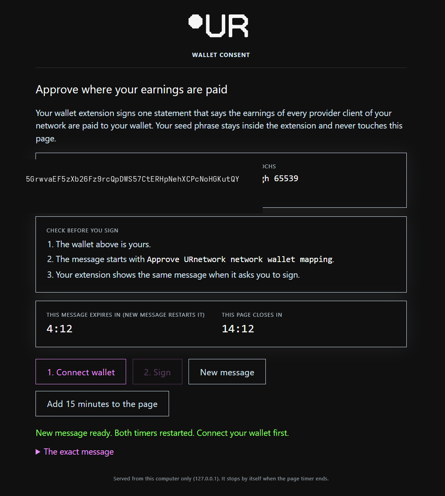

# Approve where your earnings are paid

Your providers' earnings are paid to one wallet address, and the network only accepts that address once you sign a statement with it. This page covers that signing step: fetch the statement, sign it in your wallet extension, and confirm the network stored it. You need this once per network, and again only when you want to change the wallet or extend the epoch range.

## Before you start

- A provider that has authenticated at least once, so the tool can find it.
- A browser on the same machine, with a Polkadot extension installed: Polkadot.js, Talisman, SubWallet or Nova.
- The wallet address (an SS58 address, `5…`) your earnings should be paid to.

## Steps

**1. Check whether a consent is already stored.**

```sh
urnet-tools wallet status
```

The command prints the stored consent coldkey, its epoch interval, and whether it is in effect now, still starts in an epoch, or has ended. If the address and interval are what you want, you are done: you do not need to sign again.

**2. Fetch the statement to sign.**

```sh
urnet-tools wallet challenge 5CvF...your-coldkey
```

This signs nothing and changes nothing. It prints the exact statement, the epoch range it covers, and warns if the range cannot be undone. Read the range before you continue: a consent covers every provider client on the network, now and future, for the epochs it names.

**3. Open the signing page.**

```sh
urnet-tools wallet sign 5CvF...your-coldkey
```

The provider serves one page on `127.0.0.1` for fifteen minutes and opens it in your browser. The seed phrase never leaves the extension, so nothing sensitive is typed into the page.



**4. Connect, then sign.**

Press **Connect wallet** and choose the account in your extension. The page fills in the address it will sign for. Check the three items under **Check before you sign**, then press **Sign**. Your extension shows the same statement; approving it there is the signature.

The page and the terminal both report the network's receipt. The page stops by itself when its timer ends, and **Add 15 minutes to the page** extends it if you need longer.

**5. Confirm it was stored.**

```sh
urnet-tools wallet status
```

The coldkey and epoch interval you signed should now appear as the stored consent.

## Signing from a remote box

The page only listens on `127.0.0.1`, so it must run on the machine with the browser. If the provider runs on a server you reach over SSH, forward the port in your SSH session and open the page locally:

```sh
ssh -L 8765:127.0.0.1:8765 you@server
urnet-tools wallet sign 5CvF...your-coldkey --no-open
```

Then browse to `http://127.0.0.1:8765` on your own machine. Use `--port 9000` (and forward the matching port) if 8765 is already taken.

## What this does not tell you

- `wallet status` reports the stored consent, not a payment. A consent in effect means settlement is configured to pay the address; it does not prove that any epoch has paid out.
- A successful signature is not a check that the address is correct. The network pays whatever you signed, and a later consent has to start at a later epoch than the one before it.
- The page timer bounds the signature, not the consent. Once accepted, the consent stays until a later one replaces it or its epoch range ends.
